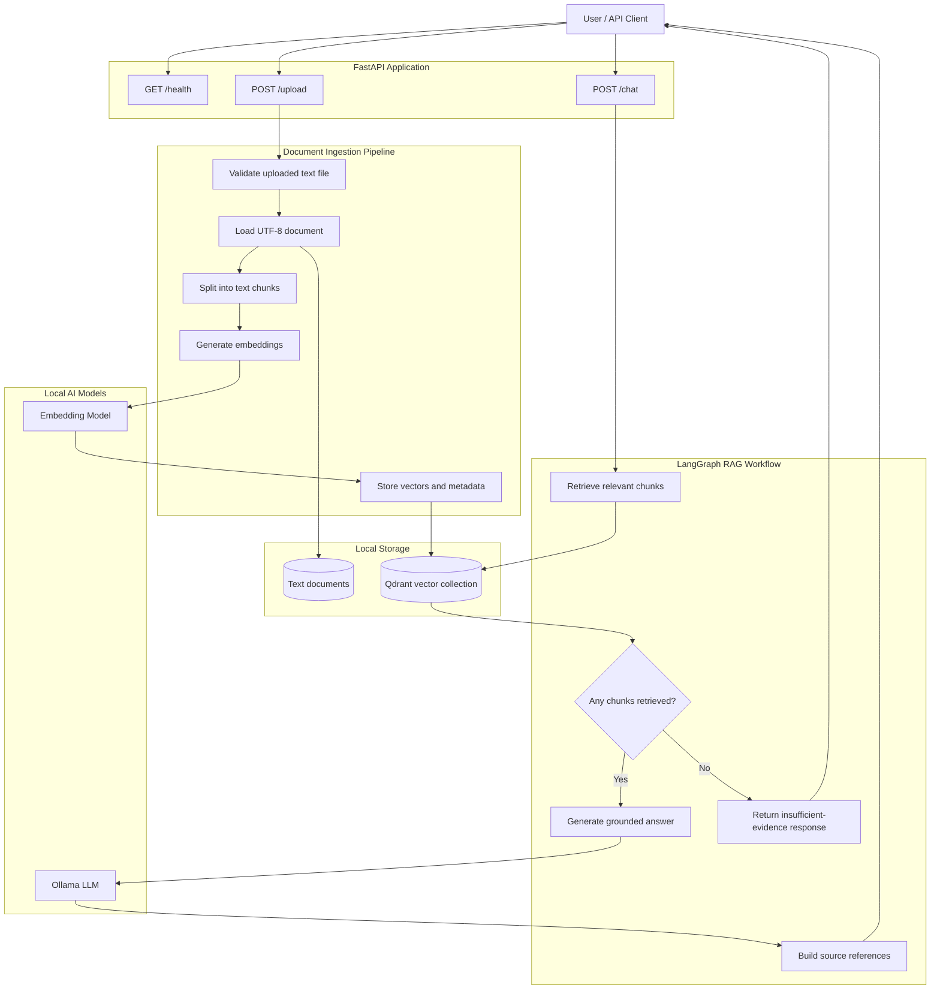
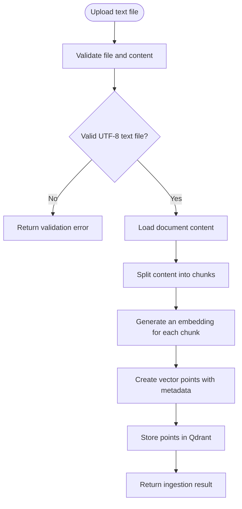
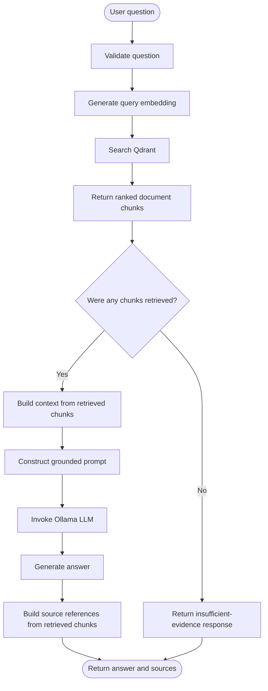
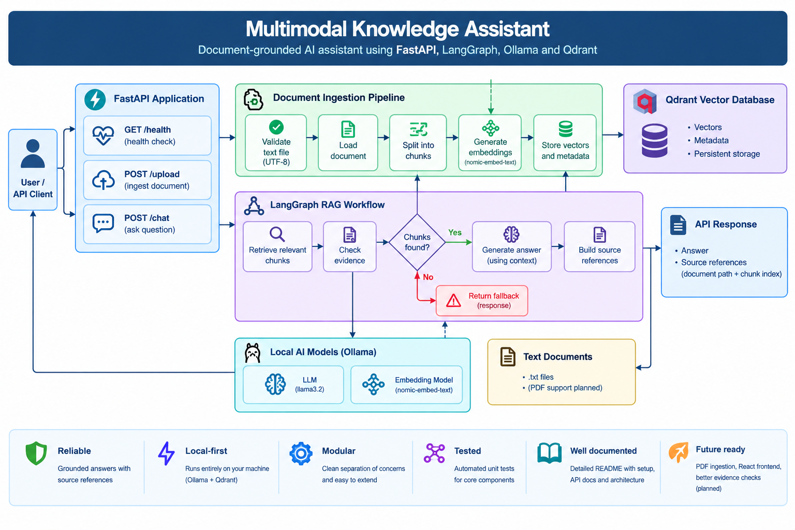
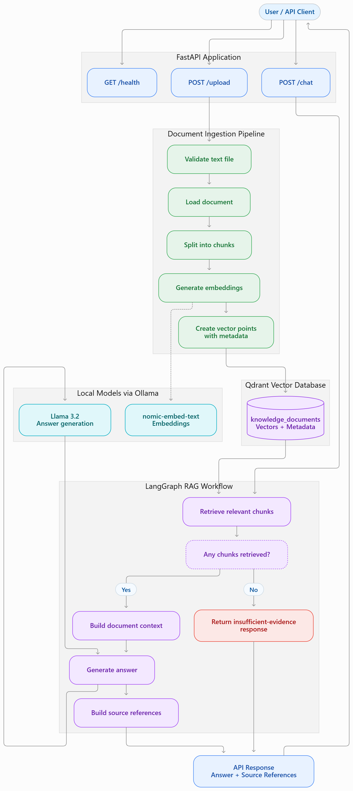

# Multimodal Knowledge Assistant

A document-grounded AI assistant built with **Python, FastAPI, LangGraph, Ollama, and Qdrant**. The application ingests text documents, generates embeddings, retrieves relevant passages, and uses a locally running large language model (LLM) to answer questions using retrieved context.

> **Project status:** Core text-based RAG workflow implemented. PDF ingestion and the React frontend are planned for future iterations.

## Table of Contents

- [Overview](#overview)
- [Key Features](#key-features)
- [Architecture](#architecture)
- [Detailed Workflow](#detailed-workflow)
- [Technology Stack](#technology-stack)
- [Project Structure](#project-structure)
- [Prerequisites](#prerequisites)
- [Installation and Setup](#installation-and-setup)
- [Running the Application](#running-the-application)
- [API Documentation](#api-documentation)
- [Testing](#testing)
- [Configuration and Data Storage](#configuration-and-data-storage)
- [Design Decisions](#design-decisions)
- [Current Limitations](#current-limitations)
- [Roadmap](#roadmap)
- [Contributing](#contributing)

## Overview

Large language models can produce incorrect answers or respond without access to an application's private documents. Retrieval-Augmented Generation (RAG) addresses this problem by retrieving relevant information from a knowledge base and supplying it to the model as context.

This project implements a local-first RAG pipeline with explicit workflow orchestration.

Given a user's question, the application:

1. Converts uploaded text documents into manageable chunks.
2. Generates vector embeddings for the chunks.
3. Stores the vectors and associated metadata in a local Qdrant collection.
4. Retrieves relevant chunks when a question is submitted.
5. Uses LangGraph to orchestrate retrieval, evidence checking, and answer generation.
6. Returns an answer alongside source references for the retrieved chunks.

The application uses Ollama for local model inference, reducing dependence on paid hosted LLM APIs.

## Key Features

- **Document ingestion:** Upload and process UTF-8 text documents.
- **Text chunking:** Split long documents into smaller passages for retrieval.
- **Embedding generation:** Generate semantic vector representations using a local embedding model.
- **Vector search:** Store and retrieve document vectors using Qdrant.
- **Agent workflow orchestration:** Coordinate retrieval, evidence checks, answer generation, and fallback handling with LangGraph.
- **Grounded answer generation:** Supply retrieved document passages to the LLM as context.
- **Source references:** Return source paths and chunk indexes associated with retrieved content.
- **Fallback handling:** Return a predefined response when retrieval produces no chunks.
- **REST API:** Expose ingestion and question-answering functionality through FastAPI.
- **Interactive API documentation:** Explore and test endpoints using Swagger UI.
- **Automated testing:** Validate ingestion, splitting, embeddings, vector storage, retrieval, and workflow behavior.

## Architecture

The system is divided into API, ingestion, service, orchestration, model, and storage responsibilities.



## Detailed Workflow

### 1. Document ingestion

When a client uploads a text document, the ingestion pipeline validates and reads the file, splits its contents, generates embeddings, and stores the resulting chunks.



Each stored chunk contains information such as:

- Text content
- Source document path
- Chunk index
- Embedding vector

This metadata allows the application to associate retrieved vectors with their original document locations.

### 2. Question answering

The question-answering pipeline uses LangGraph to coordinate retrieval, evidence checking, and generation.



**Evidence handling:** The current workflow checks whether retrieval returned any chunks. A non-empty result triggers answer generation; an empty result triggers the fallback response. This is a basic retrieval check, not a full semantic assessment of whether the retrieved passages adequately answer the question.

**Source handling:** The API returns references to retrieved chunks. These references identify the evidence candidates supplied to the workflow; they do not guarantee that every generated claim is independently supported by every returned chunk.

### 3. LangGraph state and control flow

LangGraph manages the data passed between workflow nodes using a shared state.

| Node | Responsibility |
|---|---|
| `retrieve_documents` | Retrieve relevant chunks from Qdrant. |
| `check_evidence` | Check whether any chunks were returned. |
| `generate_answer` | Build context and generate an answer using Ollama. |
| `return_fallback` | Return a predefined response when no chunks are retrieved. |

The workflow follows a conditional path:

- **Evidence found:** Generate an answer using the retrieved context.
- **No evidence found:** Return the insufficient-evidence response.

This separation makes the workflow easier to test, maintain, and extend.

## Technology Stack

| Technology | Purpose |
|---|---|
| Python | Application logic and pipeline implementation |
| FastAPI | REST API framework |
| LangGraph | Stateful workflow orchestration |
| LangChain | LLM and embedding integrations |
| Ollama | Local model inference |
| Llama 3.2 | Local language model |
| `nomic-embed-text` | Embedding model |
| Qdrant | Vector storage and similarity search |
| Pydantic | Request validation and data schemas |
| `uv` | Python environment and dependency management |
| Pytest | Automated testing |
| Ruff | Python linting and code-quality checks |

## Project Structure

```text
multimodal-knowledge-assistant/
├── app/
│   ├── api/
│   │   └── ingestion/
│   │       ├── document_loader.py
│   │       ├── text_splitter.py
│   │       └── ingestion_pipeline.py
│   ├── core/
│   │   └── config.py
│   ├── graph/
│   │   ├── state.py
│   │   ├── nodes.py
│   │   └── workflow.py
│   ├── schemas/
│   │   └── chat.py
│   ├── services/
│   │   ├── embedding_service.py
│   │   ├── llm_service.py
│   │   ├── retrieval_service.py
│   │   ├── rag_service.py
│   │   └── vector_store.py
│   └── main.py
├── documents/
│   └── rag_basis.txt
├── tests/
│   ├── test_document_loader.py
│   ├── test_text_splitter.py
│   ├── test_ingestion_pipeline.py
│   ├── test_embedding_service.py
│   ├── test_vector_store.py
│   ├── test_retrieval_service.py
│   ├── test_rag_service.py
│   └── test_workflow.py
├── notebooks/
├── requirements.txt
├── pyproject.toml
├── .gitignore
└── README.md
```

The structure above describes the main modules; some directories may contain additional files as the project evolves. Uploaded documents and local Qdrant storage are runtime data, not application source code.

## Architecture Overview



## Architecture flowchart



## Prerequisites

Install the following before running the project:

- Python 3.12 or a compatible Python version.
- [`uv`](https://docs.astral.sh/uv/) for Python environment and package management.
- [Ollama](https://ollama.com/) installed and running locally.
- Git for version control.

The application uses local Ollama models. Ensure the required models are available before running ingestion or chat requests.

## Installation and Setup

### 1. Clone the repository

```bash
git clone https://github.com/sharmaanish/multimodal-knowledge-assistant.git
cd multimodal-knowledge-assistant
```

### 2. Create the Python environment

```bash
uv venv
```

Activate it in PowerShell:

```powershell
.venv\Scripts\Activate.ps1
```

### 3. Install dependencies

If `requirements.txt` is the dependency source for your current checkout:

```bash
uv pip install -r requirements.txt
```

Keep the dependency list and project configuration synchronized as the project evolves.

### 4. Download the Ollama models

Run these commands in your terminal:

```bash
ollama pull llama3.2
ollama pull nomic-embed-text
```

Ensure the Ollama service is running and that the model names match those configured by the application.

### 5. Review application configuration

Review `app/core/config.py` and `app/services/llm_service.py` to verify the configured Ollama URL and model names.

Do not commit secrets, local credentials, or private documents to version control.

## Running the Application

Start the FastAPI development server:

```bash
uv run uvicorn app.main:app --reload
```

The application should be accessible at:

- **API base URL:** http://127.0.0.1:8000
- **Swagger UI:** http://127.0.0.1:8000/docs
- **ReDoc:** http://127.0.0.1:8000/redoc

The server must remain running while you test API requests.

## API Documentation

### Health check

`GET /health`

Checks whether the API health endpoint is reachable.

### Upload a text document

`POST /upload`

Uploads and ingests a supported text file.

Use the Swagger UI to select a `.txt` file and submit the multipart form request. On success, the response reports the ingestion result and number of chunks stored.

The current implementation supports text files; PDF ingestion is not yet implemented.

### Ask a question

`POST /chat`

Example request:

```json
{
  "question": "What are the main components of a RAG system?"
}
```

Example response:

```json
{
  "answer": "The main components of a RAG system include document ingestion, text splitting, embedding generation, vector storage, retrieval, and answer generation.",
  "sources": [
    {
      "source": "documents/rag_basis.txt",
      "chunk_index": 0
    }
  ]
}
```

The response above is illustrative. Actual answers and source references depend on the documents ingested, retrieved chunks, and model output.

## Testing

Run the complete automated test suite:

```bash
uv run pytest -v
```

Run an individual test module:

```bash
uv run pytest tests/test_workflow.py -v
```

Run lint checks:

```bash
uv run ruff check .
```

The tests cover the main ingestion, embedding, vector-store, retrieval, service, and LangGraph workflow components.

Before pushing changes, run the complete test suite and resolve any failures.

## Configuration and Data Storage

### Vector database

The project uses Qdrant in local persistent-storage mode, with the collection configured as `knowledge_documents`.

The local storage directory is configured in `app/services/vector_store.py`. Treat this directory as application data rather than source code.

### Models

- **LLM:** `llama3.2`
- **Embedding model:** `nomic-embed-text`

The embedding model converts document chunks and queries into vectors for similarity search. The LLM generates answers using retrieved context.

### Uploaded documents

Uploaded text documents are saved under the application's upload directory. Uploaded documents and vector data may contain private information; keep local runtime data out of public repositories.

## Design Decisions

### Local-first inference

Ollama keeps model inference on the local machine, avoiding a mandatory paid hosted-LLM API for the current development workflow.

### Explicit workflow orchestration

LangGraph separates retrieval, evidence checking, generation, and fallback handling into individual nodes. This makes the workflow easier to understand and test than a single monolithic function.

### Separation of responsibilities

- API routes handle client requests.
- Ingestion modules load and split documents.
- Embedding services generate vectors.
- Vector-store and retrieval services manage search operations.
- LangGraph orchestrates the RAG workflow.
- The LLM service encapsulates model access.

### Automated testing

Unit tests provide fast feedback when individual modules or workflow behavior change. API-level and end-to-end tests can be added as the application grows.

## Current Limitations

- Only text-file ingestion is implemented; PDF support is planned.
- Evidence sufficiency currently checks whether retrieval returned any chunks, not whether those chunks fully answer the question.
- Source references identify retrieved chunks and are not yet guaranteed to provide claim-level citation verification.
- The project currently exposes a backend API; a React user interface has not been added.
- Production deployment, authentication, authorization, rate limiting, and comprehensive observability are future considerations.

## Roadmap

- [x] Text document loading and chunking
- [x] Local embedding generation
- [x] Qdrant vector storage and retrieval
- [x] Ollama-based answer generation
- [x] LangGraph workflow and fallback branch
- [x] FastAPI endpoints and Swagger documentation
- [x] Automated unit tests for core modules
- [ ] Improve semantic evidence sufficiency checks
- [ ] Improve claim-level source attribution and citation verification
- [ ] Add PDF ingestion
- [ ] Build a React frontend for document upload and chat
- [ ] Add integration and end-to-end tests
- [ ] Add structured logging and evaluation metrics
- [ ] Add deployment configuration and production security controls

## Contributing

Contributions and suggestions are welcome.

1. Fork the repository.
2. Create a focused feature branch.
3. Make a small, well-scoped change.
4. Add or update tests.
5. Run the test suite and lint checks.
6. Open a pull request describing the change and its validation.

## License

A license has not yet been specified. Add a `LICENSE` file before presenting the repository as open-source software.
